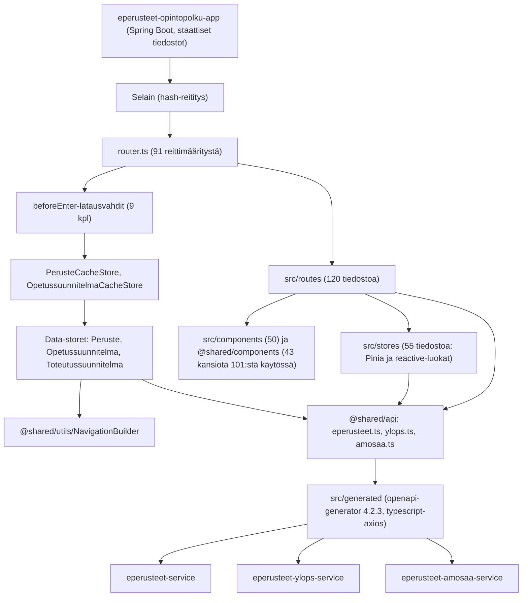
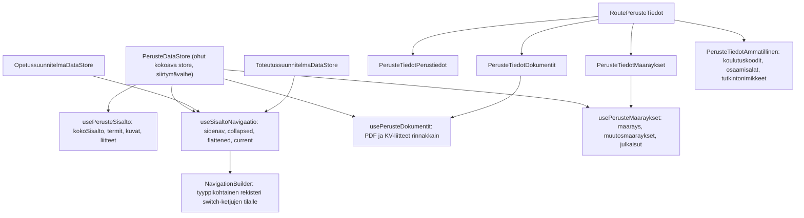
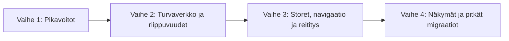

# eperusteet-opintopolku - parannussuunnitelma

| Tieto | Arvo |
|---|---|
| Dokumentin luontipäivä | 22.10.2026 |
| Laatija | Cursor-agentti |
| Käytetty malli | Claude Opus 5.5 |
| Laajuus | `eperusteet-opintopolku` (julkinen käyttöliittymä: Vue 3.5.41, Vite 7.3.6, TypeScript 5.9.3, Pinia 2.3.1, PrimeVue 4.5.5), submodule `eperusteet-frontend-utils/vue` sekä Java-moduuli `eperusteet-opintopolku-app` (Spring Boot 4.1.1, Java 21) |
| Koko | `src`: 150 `.vue`-tiedostoa / 26 946 riviä ja 95 `.ts`-tiedostoa / 8 180 riviä (yhteensä 245 tiedostoa / 35 126 riviä). `eperusteet-frontend-utils/vue/src` (käsin kirjoitettu): 179 `.vue` / 28 270 riviä, 146 `.ts` / 12 912 riviä ja 2 `.js` / 31 riviä (yhteensä 327 tiedostoa / 41 213 riviä). Lisäksi generoitua OpenAPI-koodia 16 tiedostoa / 114 829 riviä. Testit: `src` 20 tiedostoa / 2 051 riviä, frontend-utils 64 tiedostoa / 4 305 riviä. |

Luvut perustuvat staattiseen koodianalyysiin (`wc -l`, `rg`-hakulausekkeet, käsin luetut tiedostot) sekä yhteen `tsc --noEmit` -ajoon. Ne ovat suuntaa-antavia ja kannattaa tarkistaa ennen kunkin työn aloittamista. Asennetut versiot on luettu `node_modules`-hakemistosta.

---

## 1. Yhteenveto

Sovelluksen alusta on pääosin ajan tasalla: Vue 3 -migraatio on tehty, ja käytännössä kaikki komponentit käyttävät `<script setup>`-syntaksia (`src`: 149/150, frontend-utils: 175/179, loput ovat tyhjiä tai pelkkiä template-komponentteja). Class-komponentteja, `vue-property-decorator`-kirjastoa, Options API:a tai Vue-mixinejä ei enää ole. Tekninen velka johtuu seuraavista asioista:

1. **Tyyppitarkistus puuttuu.** CI ajaa `lint`, `test` ja `build`, mutta mikään vaihe ei tarkista tyyppejä (`vue-tsc` puuttuu, eikä Vite tarkista tyyppejä). `tsc --noEmit` löytää käsin kirjoitetusta `.ts`-koodista 65 tyyppivirhettä, ja generoidusta koodista 901 virhettä. Lisäksi `noImplicitAny` on pois päältä ja ESLint-sääntö `no-explicit-any` on kytketty pois. Koodissa on 433 `: any` -merkintää ja 390 `as any` -muunnosta.
2. **Suuret ja päällekkäiset storet ja apumoduulit.** `NavigationBuilder.ts` (1122 riviä, 134 `case`-haaraa) ja `perusteet.ts` (804 riviä, 339 koulutustyyppiviittausta) ovat koko navigaation ja koulutustyyppilogiikan keskipisteitä, eikä niillä ole testejä. Kolme data-storea (`PerusteDataStore`, `OpetussuunnitelmaDataStore`, `ToteutussuunnitelmaDataStore`) toteuttavat saman sivunavigaatiologiikan kukin erikseen. Storeissa on kaksi rinnakkaista mallia: 25 Pinia-storea ja 25 `reactive`-luokkaa.
3. **Riippuvuudet.** Sovelluksen `package.json` on lähes identtinen kopio frontend-utilsin `package.json`ista (72 ja 70 riippuvuutta, kaikki `dependencies`-osiossa). Riippuvuuksista 12 ei ole käytössä lainkaan. Vue 2 -aikaisia kirjastoja on jäljellä (`vue-meta` 2.4.0, `vue-observe-visibility` 1.0.0 ja `vue-axe` 1.1.0). OpenAPI-asiakkaat generoidaan vuoden 2020 generaattorilla (4.2.3).
4. **Testit.** Sovelluksessa on 20 testitiedostoa ja 49 testitapausta. Storeille, reititykselle, navigaation rakentamiselle ja sisältöhaulle ei ole testejä. E2E-testejä ei ole, eikä kattavuutta mitata.
5. **Toimitus ja suorituskyky.** Kaikki 81 reittikomponenttia tuodaan staattisesti, joten koodia ei pilkota reiteittäin. Java-moduuli asettaa kaikille staattisille tiedostoille `max-age=365d`-välimuistiotsakkeen, mikä koskee todennäköisesti myös `index.html`ää.

Suurin hyöty saadaan ottamalla tyyppitarkistus käyttöön, kirjoittamalla testit navigaation rakentamiselle ja data-storeille sekä pilkkomalla `NavigationBuilder`, data-storet ja `router.ts`. Pienimmällä työllä saadaan pikavoittoja: poistetaan käyttämättömät ja Vue 2 -aikaiset riippuvuudet, korjataan välimuistiotsakkeet ja siivotaan kuollut koodi.

---

## 2. Arkkitehtuuri

### 2.1 Kerrokset

**Sovellus (`src`)**

| Kansio | Tiedostoja | Rivejä (noin) | Rooli |
|---|---:|---:|---|
| `routes` | 120 | 21 400 | Reittinäkymät koulutustyypeittäin (perusteet, opetussuunnitelmat, toteutussuunnitelmat, ammatillinen, kooste, määräykset, osaamismerkit, uutiset) |
| `components` | 50 | 8 400 | Sovelluskohtaiset komponentit (sivunavigaatio, header, footer, ammatillisen rakenne, määräykset). Sisältää 746-rivisen testidatatiedoston. |
| `stores` | 55 | 3 500 | Pinia-storet, `reactive`-luokat ja niiden rajapinnat |
| `utils` | 8 | 740 | Murupolku, navigointi, sisältöhaku, vanhojen osoitteiden uudelleenohjaukset |
| `api` | 1 | 130 | Sovelluskohtainen API-apu |
| `test` | 2 | 50 | Vitestin setup ja yhteiset mockit |
| Juuritiedostot | 9 | 900 | `main.ts`, `router.ts` (705 riviä), `App.vue`, `pinia.ts`, `registerServiceWorker.ts` |

**Jaettu kirjasto (`eperusteet-frontend-utils/vue/src`)**

| Kansio | Tiedostoja | Rivejä (noin) | Rooli |
|---|---:|---:|---|
| `components` | 254 | 34 200 | Jaetut komponentit (101 kansiota), myös virkailijasovellusten editointikomponentit |
| `utils` | 28 | 3 600 | `NavigationBuilder`, `perusteet`, apufunktiot, testiapurit |
| `stores` | 16 | 1 200 | `Kielet`, `BrowserStore`, `virheet`, `murupolku` ja vanha Vuex-pohjainen `store.ts` |
| `api` | 6 | 850 | Axios-instanssit, interceptorit ja generoitujen asiakkaiden kääreet |
| `plugins` | 10 | 700 | `kaannos`, `aikaleima` (moment), notifikaatiot |
| `directives`, `validators`, `config`, `composables` | 8 | 400 | Direktiivit, Vuelidate-validaattorit, oletuskomponenttien rekisteröinti |
| `generated` | 16 | 114 800 | OpenAPI-asiakkaat (eperusteet, ylops, amosaa, ai). Ei versionhallinnassa. |

### 2.2 Poikkileikkaavat ratkaisut

- **Reititys:** Vue Router 4.6.4 ja `createWebHashHistory`. Kaikki reitit ovat `/:lang`-juurireitin alla. `router.ts` tuo 81 `.vue`-komponenttia staattisesti, eikä yhtään reittiä ladata dynaamisesti (`import()`-kutsuja 0). Datan lataus tehdään yhdeksässä `beforeEnter`-vahdissa, joissa on lähes identtinen `try/catch`-rakenne ja `Virheet.lisaaVirhe`-kutsu. Vahdit käyttävät `next()`-callbackia (23 kutsua). `utils/redirects.ts` (125 riviä) sisältää vanhojen osoitteiden uudelleenohjaukset. Niistä neljä käyttää Vue Router 3:n `/*/`-jokerimerkkiä, jota Vue Router 4 käsittelee kirjaimellisena tähtimerkkinä, joten ne eivät todennäköisesti koskaan osu.
- **Tilanhallinta:** Pinia 2.3.1. `src/stores`-kansiossa on 25 Pinia-storea, 25 `reactive`-luokkaa, 4 rajapintatiedostoa ja yksi tyhjä tiedosto (`EtusivuStore.ts`). Data-storet luodaan dynaamisesti avaimella (`perusteStore-<id>-<revisio>`), ja cache-storet säilyttävät jokaisen avatun perusteen tai suunnitelman koko sisällön muistissa ilman rajaa. Frontend-utilsissa `Kielet`, `BrowserStore` ja useat muut storet ovat luokkia, ja `stores/store.ts` on Vuex-pohjainen dekoraattorimalli, vaikka Vuex ei ole riippuvuuksissa.
- **Kieliversiot:** `vue-i18n` 11.4.10 Composition-tilassa (`legacy: false`). Käännöstiedostot ovat frontend-utilsissa (`locale-fi.json` 4742 avainta / 328 kt, `locale-sv.json` 2106 avainta / 134 kt, `locale-en.json` 106 avainta / 7 kt), ja ne tuodaan sekä `main.ts`:ssä että `kieli.ts`:ssä. Käynnistyksessä `App.vue` yhdistää lisäksi lokalisointipalvelun käännökset (`getKaannokset`, joka palauttaa virhetilanteessa tyhjän olion). Sisällön monikielisyys hoidetaan `$kaanna`-pluginilla (623 käyttöä `src`:ssä) ja käyttöliittymätekstit `$t`:llä (610 käyttöä).
- **Metatiedot ja analytiikka:** `@unhead/vue` (`useHead` 15 tiedostossa) ja `vue-matomo`. `router.ts` tuo edelleen `vue-meta`-kirjaston, ja `Root.vue` sekä kaksi muuta tiedostoa käyttävät `vue-meta`n `vmid`-kenttää (8 kpl).
- **API-asiakkaat:** `buildapi.sh` generoi `typescript-axios`-asiakkaat komennolla `@openapitools/openapi-generator-cli@1.0.18-4.2.3` OpenAPI-kuvauksista, jotka haetaan backend-repositorioiden `generated/*.spec.json`-tiedostoista (CI:ssä haaran mukaan, muuten `master`). `@shared/api/*.ts` luo axios-instanssit, interceptorit ja `Caller-Id`-otsakkeen. 42 `.vue`-tiedostoa tuo API-asiakkaita suoraan.
- **Build:** Vite 7.3.6 (`@vitejs/plugin-vue`, `vite-plugin-commonjs`, `@tailwindcss/vite`). Sass-varoituksista vaiennetaan neljä luokkaa (`color-functions`, `global-builtin`, `import`, `abs-percent`). `tsconfig.json`: `target: es5`, `strict: true`, `noImplicitAny: false`. Kehityspalvelin välittää kutsut kolmeen backendiin.
- **SSR:** Ei käytössä. Sovellus on puhdas SPA, eikä sitä esirenderöidä.
- **Java-moduuli `eperusteet-opintopolku-app`:** Spring Boot 4.1.1 -sovellus, jossa on kolme luokkaa. Se tarjoilee rakennetun käyttöliittymän (`src/main/resources/static`), ohjaa juuripolun `index.html`ään (`RootController`) ja tarjoaa `/digiosaaminen`-ohjauksen (`DigiOsaaminenServlet`). Asetus `spring.web.resources.cache.cachecontrol.max-age=365d` koskee kaikkia staattisia tiedostoja. Moduulissa ei ole testejä.
- **CI:** `.github/workflows/build.yml` ajaa jokaisella pushilla kolme jobia: (1) frontend-utilsin `yarn install` ja `buildapi.sh`, minkä jälkeen juuressa `yarn install`, `yarn lint`, `yarn test` ja `yarn build`, (2) `mvn clean verify`, joka paketoi käyttöliittymän JARiin, ja (3) kontin rakentaminen `ci-tools`-työkaluilla. Tyyppitarkistusta, kattavuusraporttia ja riippuvuuksien haavoittuvuusskannausta ei ajeta.

### 2.3 Havainnot

- Kerrosjako on selkeä (reitit, storet, jaettu API-kerros), mutta rajapintakutsuja tehdään myös suoraan näkymistä, ja koulutustyyppikohtainen logiikka on hajallaan näkymissä (569 koulutustyyppiviittausta `src`:ssä).
- Frontend-utils on jaettu neljän käyttöliittymän kesken (`eperusteet-ui`, `eperusteet-ylops-ui`, `eperusteet-amosaa-ui`, `eperusteet-opintopolku`). Opintopolku käyttää 43 sen 101 komponenttikansiosta. Suurimmat utils-komponentit (`EpTiedoteModal`, `EpEditointi`, `EpKayttaja`) eivät ole tämän sovelluksen käytössä.
- `components.d.ts` on `unplugin-vue-components`-työkalun generoima, mutta työkalu ei ole asennettuna, joten tiedosto ei päivity.
- Versionhallinnassa on vanhan AngularJS-käyttöliittymän arkistot `eperusteet-opintopolku-ui-2015.zip` (1,24 Mt) ja `eperusteet-frontend-utils/angularjs-2015-components.zip` (50 kt).

---

## 3. Sovelluslogiikka

### 3.1 Perusteen ja suunnitelman avaaminen

- Reitti ei renderöidy ennen kuin koko perusteen sisältö (`getKokoSisalto`) ja kaikki oheistiedot on ladattu. Latauksessa on neljä peräkkäistä vaihetta, ja ammatillisten perusteiden KV-liitteet haetaan kieli kerrallaan.
- Jos lataus epäonnistuu, vahti kirjaa virheen ja kutsuu silti `next()`. Tällöin `getCachedPerusteStore` palauttaa `undefined`n ja `getCachedOpetussuunnitelmaStore` tyhjän olion, joten näkymät joutuvat varautumaan puuttuvaan storeen.
- Opetussuunnitelmissa ja toteutussuunnitelmissa on vastaava rakenne (`OpetussuunnitelmaCacheStore` ja `addAndGetCachedStore`). `OpetussuunnitelmaDataStore` lataa lisäksi pohjana olevan perusteen sisällön, termit ja kuvat.

### 3.2 Navigaatiopuu

- Backend palauttaa navigaation `NavigationNodeDto`-puuna (`getNavigationPublic`). Data-storet muuntavat puun `@shared/utils/NavigationBuilder`illa, joka kuvaa sisältötyypit (77 eri `case`-arvoa) reiteiksi ja näkymädataksi neljässä `switch`-lauseessa (`navigationNodeDtoToPerusteRoute`, `osaToLocation`, `setPerusteData` ja `setOpetussuunnitelmaData`, yhteensä 134 `case`-haaraa).
- Kukin kolmesta data-storesta toteuttaa itse laskennat `sidenav`, `collapsedSidenav`, `flattenedSidenav`, `current` ja `updateRoute`. Nykyinen solmu etsitään käymällä koko litistetty puu läpi `_.isMatch`-vertailulla aina reitin vaihtuessa.
- `NavigationBuilder`, kolme muuta frontend-utilsin tiedostoa ja kaikki kolme data-storea käyttävät `vue-router`in `Location`-tyyppiä, jota Vue Router 4 ei enää tarjoa (yhteensä 7 tiedostoa). Tämä ei näy, koska tyyppejä ei tarkisteta.

### 3.3 Haku

- Etusivun haku (`EpEtusivuHaku`, 427 riviä) ja ammatillisen haku (`PerusteAmmatillinenHaku`, 449 riviä) käyttävät backendin hakurajapintoja Pinia-storejen kautta (`PerusteHakuStore`, `AmmatillinenPerusteHakuStore`).
- Perusteen ja opetussuunnitelman sisältöhaku (`utils/sisaltohaku.ts`) tehdään selaimessa koko ladatusta sisällöstä. HTML-sisältö muunnetaan tekstiksi asettamalla se irrallisen `div`-elementin `innerHTML`-kenttään. Tämä on hidasta suurilla perusteilla, ja selain lataa samalla sisällön kuvat ja suorittaa niiden tapahtumankäsittelijät.

### 3.4 Välimuisti

- Perusteet, opetussuunnitelmat ja toteutussuunnitelmat säilyvät cache-storeissa koko istunnon ajan avaimella `<id>-<revisio>`. Kokoa ei rajata, eikä välimuistia tyhjennetä. Jokainen avattu peruste pitää muistissa koko `PerusteKaikkiDto`n.
- Välimuisti nopeuttaa siirtymiä saman perusteen sisällä, mutta revisioiden ja usean perusteen selaaminen kasvattaa muistinkäyttöä.

### 3.5 Komponenttimalli ja Vue 2 -jäänteet

| Tunnusluku | `src` | frontend-utils |
|---|---:|---:|
| `.vue`-tiedostoja, joissa on `<script setup>` | 149/150 | 175/179 |
| Options API (`export default {`) | 0 | 0 |
| `defineComponent` | 0 | 3 (vain testeissä) |
| `@Component` / `vue-property-decorator` | 0 / 0 | 0 / 0 |
| Vue-mixinit | 0 | 0 |
| `import Vue from 'vue'` (Vue 2 -tyylinen) | 1 (testi) | 12 (6 tuotantotiedostoa, 5 testiä, 1 `.not`-tiedosto) |
| `vue-router`in `Location`-tyyppi (poistunut Vue Router 4:ssä) | 3 | 4 |
| `propsData` testeissä (Vue 2 -nimi) | 27 | - |
| `: any` / `as any` | 157 / 250 | 276 / 140 |
| `defineProps` tyyppiparametrilla / ajonaikaisella määrittelyllä | 4 / 53 | - |

Vue 3 -migraatio on tehty perusteellisesti. Jäljellä on lähinnä jäänteitä: Vue 2 -kirjastoja `package.json`issa, `vue-meta`n `vmid`-kentät, `Location`-tyyppi, Vuex-pohjainen `store.ts` testeineen, `.not`- ja `.old`-tiedostot sekä `migration/vue_migration_guide.txt`.

---

## 4. Suuret komponentit, storet ja apumoduulit

### 4.1 Suurimmat tiedostot

| Tiedosto | Rivejä | Huomiot |
|---|---:|---|
| `utils: utils/NavigationBuilder.ts` | 1122 | 134 `case`-haaraa neljässä `switch`-lauseessa, 14 `any`-merkintää, `Location`-tyyppi Vue Router 3:sta. Käytössä 17 tiedostossa `src`:ssä. Ei testejä. |
| `utils: utils/perusteet.ts` | 804 | 79 exportia ja 339 koulutustyyppiviittausta. Koulutustyyppien metatieto (värit, ikonit, reitit, ryhmät) on hajallaan funktioissa ja taulukoissa. |
| `src/routes/perusteet/tiedot/RoutePerusteTiedot.vue` | 747 | Scriptiä 308 riviä, 34 `computed`/`watch`-lausetta. Määräysten ja muutosmääräysten yhdistely (4 laskentaa), dokumenttien kielistys ja ammatillisten kenttien muodostus (koulutuskoodit, osaamisalat, tutkintonimikkeet, koulutusviennin ohje) ovat näkymässä. 16 koulutustyyppiviittausta. |
| `src/routes/opetussuunnitelmat/sisalto/lops2019/opintojaksot/RouteOpetussuunnitelmaOpintojakso.vue` | 742 | Scriptiä 389 riviä, 43 `computed`/`watch`-lausetta. Opintojakson, moduulien, paikallisten oppiaineiden ja laaja-alaisten yhdistely näkymässä. |
| `src/router.ts` | 705 | 91 reittimääritystä, 81 staattista komponentti-importtia, 9 latausvahtia samalla `try/catch`-rakenteella, 4 `beforeEach`-vahtia. Käyttämättömät `vue-meta`- ja `vue-scrollto`-importit. 3 tyyppivirhettä. |
| `utils: components/EpTiedoteModal/EpTiedoteModal.vue` | 1169 | Ei käytössä tässä sovelluksessa. Scriptiä 601 riviä, 15 `any`-merkintää, 40 koulutustyyppiviittausta. |
| `utils: components/EpEditointi/EpEditointi.vue` ja `EditointiStore.ts` | 1075 ja 577 | Ei käytössä tässä sovelluksessa. `EditointiStore`ssa 22 `any`-merkintää ja 2 tyyppivirhettä. |
| `src/components/EpToteutussuunnitelma/EpToteutussuunnitelmaTutkinnonosa.vue` | 492 | Scriptiä 205 riviä, tutkinnon osan rakenteen muunnos näkymässä. |
| `src/components/EpMaarayskokoelmaMaarays/EpMaarayskokoelmaMaarays.vue` | 482 | 9 `any`-merkintää, 12 koulutustyyppiviittausta. |
| `src/routes/perusteet/sisalto/lops2019/oppiaineet/OppiaineEsitys.vue` | 470 | Scriptiä 242 riviä, 21 `computed`/`watch`-lausetta. |
| `src/stores/OpetussuunnitelmaDataStore.ts` | 451 | 15 `await`-kutsua, latauksessa peräkkäisiä vaiheita, 9 `any`-merkintää, `Location`-tyyppi. Sivunavigaatiologiikka on kopio `PerusteDataStore`sta. |
| `src/routes/ammatillinen/PerusteAmmatillinenHaku.vue` | 449 | 17 koulutustyyppiviittausta, hakuehdot ja tulosten muotoilu samassa komponentissa. |
| `src/routes/perusteet/sisalto/perusopetus/RoutePerusopetusOppiaine.vue` | 441 | 9 `any`-merkintää. |
| `src/routes/opetussuunnitelmat/sisalto/perusopetus/RouteTavoitteetSisallotArviointi.vue` | 440 | Scriptiä 284 riviä, 27 `computed`/`watch`-lausetta. |
| `src/routes/opetussuunnitelmat/sisalto/aipe/RouteAipeOppiaine.vue` ja `perusteet/sisalto/aipe/RouteAipeOppiaine.vue` | 431 ja 371 | Rinnakkaiset peruste- ja ops-versiot, joissa on 562 eroavaa riviä. Samoin `RouteAipeKurssi` ja `RouteAipeVaihe`. |
| `src/routes/home/EpEtusivuHaku.vue` | 427 | 39 koulutustyyppiviittausta, tyylejä 156 riviä. |
| `src/routes/kooste/RouteKooste.vue` | 415 | 38 koulutustyyppiviittausta. |
| `src/stores/ToteutussuunnitelmaDataStore.ts` | 363 | 18 `await`-kutsua, sivunavigaatiologiikka kopioitu. |
| `src/stores/PerusteDataStore.ts` | 337 | Sisältö, navigaatio, dokumentit, KV-liitteet, määräykset ja julkaisut samassa storessa. KV-liitteet haetaan peräkkäin. |

### 4.2 Yleiset havainnot

- **Komponenttimalli:** `<script setup>` on käytössä kaikkialla. Yksikään tiedosto ei käytä Options API:a tai class-komponentteja, joten jäljellä oleva velka on rakenteellista eikä syntaksiin liittyvää.
- **Vastuut:** Suurimmissa näkymissä datan muokkaus (yhdistely, suodatus, kielistys) tehdään `computed`-lausekkeissa näkymässä. Tätä ei voi testata ilman komponentin mounttausta.
- **Koulutustyypit:** Koulutustyyppikohtaisia haaroja on `src`:ssä 569 ja `perusteet.ts`:ssä 339. Uuden koulutustyypin lisääminen vaatii muutoksia `router.ts`:ään, `NavigationBuilder`iin, `perusteet.ts`:ään ja useisiin näkymiin.
- **Rinnakkaiset näkymät:** Perusteen ja opetussuunnitelman AIPE-, perusopetus- ja lops2019-näkymät ovat erillisiä mutta rakenteeltaan samankaltaisia tiedostoja.
- **Storemallit:** Pinia ja `reactive`-luokat ovat käytössä rinnakkain. Osa siirtymästä on kesken: `Lops2019OppiaineStore.ts` ja `LopsOpetussuunnitelmaOppiaineStore.ts` sisältävät Pinia-storen lisäksi taaksepäin yhteensopivan luokan, joka vain delegoi Pinia-storelle. Frontend-utilsissa on lisäksi kirjoitusvirheellinen kaksoiskappale `TietoapavelustaStore.ts` (`TietoapalvelustaStore.ts`:n rinnalla), ja `src/stores`-kansiossa on kolmas `TietoapalvelustaStore`.
- **Merkinnät:** TODO 0 (`src`) ja 1 (utils), FIXME 0, `console.log` 6 (`src`) ja 1 (utils), `@ts-ignore` 0, `eslint-disable` 0. Velka ei siis näy merkinnöissä, vaan rakenteessa ja tyypeissä.

### 4.3 Ehdotettu data-storejen ja `RoutePerusteTiedot`-näkymän pilkkominen

Storejen julkinen rajapinta (`getCachedPerusteStore` ja storen kentät) voidaan säilyttää siirtymävaiheen ajan, jolloin näkymät eivät muutu. Store kokoaa composablet ja palauttaa samat kentät, ja näkymät siirretään vähitellen käyttämään composableja suoraan. `useSisaltoNavigaatio` poistaa kolmeen storeen kopioidun navigaatiologiikan. `NavigationBuilder`in `switch`-ketjut korvataan rekisterillä, jossa kullekin sisältötyypille on yksi rivi: tyyppi, reitin nimi, parametrien muodostus ja näkymädata. Koska `NavigationBuilder` ja `perusteet.ts` ovat frontend-utilsissa, muutokset koskevat myös muita käyttöliittymiä (ks. luku 8).

---

## 5. Testit

| Mittari | Arvo |
|---|---|
| Testikehys | Vitest 3.2.7, `@vue/test-utils` 2.4.6, jsdom 26.1.0, `@vitest/ui` |
| Testitiedostoja (`src`) | 20 (`*.spec.ts`), 2 051 riviä |
| Testitapauksia (`src`) | 49 (`it`/`test` rivin alussa) |
| Testitiedostoja (frontend-utils) | 64, 4 305 riviä, noin 150 testitapausta |
| Ohitetut testit (`.skip`/`.todo`) | 0 (`src`) / 22 kpl 16 tiedostossa (frontend-utils) |
| Snapshot-testit | 1 (`src`) |
| Store-testit (`src/stores`, 55 tiedostoa) | 0 |
| Reititystestit | 1 (`router.spec.ts` tarkistaa vain, että reititin on olemassa) |
| E2E | Ei käytössä. Frontend-utilsin `cypress.json` on jäänne ilman Cypress-riippuvuutta. |
| Kattavuus | `vitest.config.js` määrittää raportit, mutta `@vitest/coverage-v8` ei ole asennettuna, eikä kattavuutta ajeta CI:ssä. `.codeclimate.yml` sulkee pois `*.vue`-tiedostot ja frontend-utilsin. |
| Tyyppitarkistus | Ei käytössä. `tsc --noEmit` antaa 1 115 virhettä: 901 generoidussa koodissa, 21 `node_modules`-tyypeissä, 128 `.vue`-moduulien resoluutiovirhettä (`tsc` ei tue `.vue`-tiedostoja ilman `vue-tsc`:tä) ja 65 varsinaista tyyppivirhettä käsin kirjoitetussa koodissa. |

### 5.1 Testiinfrastruktuuri

| Tiedosto | Sisältö | Käyttäjiä |
|---|---|---:|
| `src/test/setup.ts` | `matchMedia`-mock ja globaalit mockit (`$t`, `$kaanna`, `$sd`, `$kaannaOlioTaiTeksti`) | Kaikki testit |
| `src/test/testInit.ts` | `vi.mock` cache-storeille ja `vue-router`ille | 6 |
| `@shared/utils/__tests__/stubs` (`globalStubs`) | Jaetut komponenttistubit | 13 |
| `@shared/utils/jestutils.ts` (155 riviä) | `mocks`, `stubs` ja apufunktiot (Jest-aikainen nimi) | 5 |

### 5.2 Havainnot

- Testit ovat pääosin mount-testejä, jotka tarkistavat, että näkymä renderöi tietyn tekstin. Logiikkaa (storet, `NavigationBuilder`, `sisaltohaku`, `murupolku`, `redirects`) ei testata erikseen.
- Sovelluksen `vitest.config.js` sulkee pois frontend-utilsin testit. Frontend-utilsin oma CI ajaa ne, mutta submodulen päivitys tähän sovellukseen ei aja niitä uudelleen tätä sovellusta vasten.
- Testeissä käytetään Vue 2 -aikaisia käytäntöjä: `propsData` (27 kpl), `await`ittomat `nextTick()`-kutsut (7 kpl) ja `as any` -muunnoksia mockeissa. Osa testeistä sisältää tyyppivirheitä (esim. `RouteAmmatillinenValmisteillaOlevat.spec.ts`, `RouteKooste.spec.ts` ja `RoutePerusteTiedot.spec.ts`).
- `vite.config.js` sisältää oman `test`-osion, jonka `setupFiles` osoittaa olemattomaan polkuun `./test/setup.ts`. Varsinainen konfiguraatio on `vitest.config.js`:ssä. Alias `&` osoittaa olemattomaan `tests`-kansioon.
- Työtilassa on erillinen `eperusteet-e2e-smoke-test`-repositorio, jota ei tarkasteltu tässä analyysissä.

---

## 6. Riippuvuudet

Sovelluksen `package.json` sisältää 72 riippuvuutta `dependencies`-osiossa ja 5 `devDependencies`-osiossa. Frontend-utilsin `package.json`issa on 70 riippuvuutta, ja listat ovat identtiset lukuun ottamatta kahta sovelluksen omaa pakettia (`vue-meta`, `vue-observe-visibility`) ja Viten versiomerkintää (`^7.3.0` / `^7.3.1`). Riippuvuudet asennetaan sovelluksen juureen, ja CI poistaa frontend-utilsin `node_modules`-hakemiston generoinnin jälkeen.

| Riippuvuus | Versio (asennettu) | Ongelma |
|---|---|---|
| `vue-meta` | 2.4.0 | Vain Vue 2:lle. Tuodaan `router.ts`:ssä, mutta ei käytetä. `vmid`-kentät (8 kpl) ovat jäänne. Korvaaja `@unhead/vue` on jo käytössä. |
| `vue-observe-visibility` | 1.0.0 | Vue 2 -direktiivi. Ei käytössä. |
| `vue-axe` | 1.1.0 | Vue 2 -versio (Vue 3:lle on oma pääversionsa). Ei käytössä. |
| Käyttämättömät paketit | `exceljs` 4.x, `file-saver`, `js-cookie`, `apexcharts`, `vue3-apexcharts`, `vue-upload-component`, `core-js` 3.50.0, `vue3-text-clamp`, `@floating-ui/dom`, `url` 0.11.4 | Ei yhtään viittausta sovelluksen eikä frontend-utilsin lähdekoodissa. `exceljs` tuo mukanaan `dayjs`in. Voivat olla muiden käyttöliittymien käytössä, mikä pitää tarkistaa. |
| `register-service-worker` | 1.7.2 | Käytössä vain `src/registerServiceWorker.ts`:ssä, jota mikään ei tuo. |
| `moment` | 2.30.1 | Ylläpitotilassa, ei tue tree-shakingia. Käytössä vain kahdessa utils-tiedostossa (`plugins/aikaleima.ts`, `stores/kieli.ts`) viiden locale-tiedoston kanssa. |
| `lodash`, `@types/lodash`, `deepdash` | 4.18.1 / 4.14.202 (lukittu) / 5.3.9 | 1110 `_.`-kutsua 171 tiedostossa `src`:ssä. Kaksi tuontitapaa (`import * as _` 56 tiedostoa, `import _` 113 tiedostoa). Tyyppimäärittely on lukittu vanhaan versioon. |
| OpenAPI-generaattori | `@openapitools/openapi-generator-cli@1.0.18-4.2.3` | Vuoden 2020 versio. Generoitu koodi tuottaa 901 TypeScript-virhettä (TS2790) nykyisellä TypeScriptillä. Versionhallinnassa on lisäksi vanhentunut `vue/generated/api.ts` (21 734 riviä), jota käyttää yksi testi. |
| `@vue/compiler-sfc` | 3.5.22 (lukittu) | Eri versio kuin `vue` 3.5.41. `yarn.lock`issa on kolme eri versiota (3.5.22, 3.5.41, 3.5.42). |
| `@primevue/themes` ja `@primeuix/themes` | 4.5.4 / 2.0.3 | `primevue.ts` käyttää molempia. `@primevue/themes` on korvattu `@primeuix/themes`-paketilla. |
| `husky` | 4.3.8 | Vanha pääversio. Hook on kytketty pois (`.huskyrc.js.no`), ja hookin kutsumaa `lint-staged`iä ei ole asennettu. |
| `@vue/eslint-config-standard-with-typescript`, `@vue/eslint-config-typescript` | 9.2.0 / 14.x | Flat-konfiguraatio (`eslint.cjs`) ei käytä kumpaakaan. Ensimmäinen on vanhentunut paketti. |
| `vite-plugin-commonjs` | 0.10.x | Lähdekoodissa ei ole yhtään `require()`-kutsua. Tarve pitää tarkistaa. |
| Kehitystyökalut `dependencies`-osiossa | `eslint`, `typescript`, `vite`, `sass`, `postcss`, `autoprefixer`, `@vitejs/plugin-vue` ym. | Ajonaikaiset ja kehitysriippuvuudet ovat sekaisin, mikä vaikeuttaa riippuvuusauditointia. |
| `pinia`, `vitest`, `jsdom` | 2.3.1 / 3.2.7 / 26.1.0 | Uudemmat pääversiot ovat saatavilla. Ei kiireellinen. |
| Java: `spring-boot-jackson2` | Boot 4.1.1 | Tarvitaan vain `DigiOsaaminenServlet`in `JsonNode`a varten. Boot 4:n oletus on Jackson 3. |

Positiivista: Vue 3.5, Vite 7, TypeScript 5.9, Vue Router 4, vue-i18n 11, PrimeVue 4, Tailwind 4 ja axios 1.x ovat ajan tasalla. Bootstrap-Vue, Vuex (riippuvuutena), Vue compat -build ja class-komponenttikirjastot on poistettu, ja Yarn 4 sekä Node 24 on lukittu (`packageManager`, `engines`).

---

## 7. Parannusehdotukset

Asteikot:

- **Vaikutus:** Korkea / Keski / Matala. Kuvaa hyötyä ylläpidettävyydelle, luotettavuudelle, suorituskyvylle tai tietoturvalle.
- **Kriittisyys:** Kriittinen / Korkea / Keski / Matala. Kuvaa, kuinka kiireellinen korjaus on riskin kannalta.
- **Työmäärä:** S (alle 2 päivää), M (noin 1 viikko), L (2-4 viikkoa), XL (yli 1 kuukausi).

### 7.1 Komponenttien ja storejen refaktorointi

| ID | Alue | Ehdotus | Perustelu / havainto | Vaikutus | Kriittisyys | Työmäärä |
|---|---|---|---|---|---|---|
| R1 | Storet | Eriytä sivunavigaation logiikka (`sidenav`, `collapsedSidenav`, `flattenedSidenav`, `current`, `updateRoute`) yhteiseksi `useSisaltoNavigaatio`-composableksi, jota kaikki kolme data-storea käyttävät. Hae nykyinen solmu avaimella (Map) koko puun läpikäynnin sijaan. | Sama logiikka on kopioitu `PerusteDataStore`en, `OpetussuunnitelmaDataStore`en ja `ToteutussuunnitelmaDataStore`en. Korjaus pitää nyt tehdä kolmeen paikkaan. | Korkea | Korkea | M |
| R2 | Storet | Pilko `PerusteDataStore` (337 riviä) ja `OpetussuunnitelmaDataStore` (451 riviä) vastuittain: sisältö, liitteet ja kuvat, dokumentit (PDF ja KV-liitteet) sekä määräykset ja julkaisut. Säilytä storen kentät kokoavana rajapintana siirtymän ajan. Hae KV-liitteet ja dokumentit rinnakkain. | Storeissa on 15 `await`-kutsua ja neljä peräkkäistä latausvaihetta, jotka viivästävät reitin renderöintiä. Yksittäistä vastuuta ei voi testata erikseen. | Korkea | Keski | M |
| R3 | Storet | Yhtenäistä storemalli: muunna 25 `reactive`-luokkaa Pinia setup -storeiksi tai composableiksi, poista tarpeettomat rajapintatiedostot ja tyhjä `EtusivuStore.ts`. Poista frontend-utilsin Vuex-pohjainen `store.ts` testeineen ja kirjoitusvirheellinen `TietoapavelustaStore.ts`. | Kaksi rinnakkaista mallia (25 Pinia ja 25 luokkaa) ja keskeneräiset siirtymät (`Lops2019OppiaineStore` ja `LopsOpetussuunnitelmaOppiaineStore` sisältävät delegoivan yhteensopivuusluokan). Luokkastoret eivät näy Pinia-devtoolsissa, eivätkä ne nollaudu testien välillä. | Keski | Keski | L |
| R4 | Välimuisti | Rajaa cache-storejen koko (esim. LRU, 5-10 sisältöä) ja käsittele latausvirhe eksplisiittisesti: ohjaa virhesivulle sen sijaan, että `next()` päästää reitille ilman storea. | Välimuisti kasvaa rajatta koko istunnon ajan, ja jokainen avattu peruste pitää muistissa koko sisältönsä. Virhetilanteessa näkymä saa `undefined`n tai tyhjän olion. | Keski | Korkea | S |
| R5 | Näkymät | Pilko `RoutePerusteTiedot` (747 riviä) alakomponenteiksi (perustiedot, määräykset, dokumentit, ammatilliset kentät) ja siirrä määräysten yhdistely sekä dokumenttien kielistys R2:n composableihin. | Näkymässä on 34 `computed`/`watch`-lausetta ja koulutustyyppikohtaista logiikkaa. Määräyslogiikkaa ei voi testata ilman mounttausta. | Keski | Keski | M |
| R6 | Näkymät | Siirrä datan muokkaus composableihin näkymissä `RouteOpetussuunnitelmaOpintojakso` (742 riviä), `RouteTavoitteetSisallotArviointi` (440), `OppiaineEsitys` (470) ja `EpToteutussuunnitelmaTutkinnonosa` (492). | Näkymissä on 17-43 `computed`/`watch`-lausetta ja 200-390 riviä scriptiä. Logiikka on testaamatonta. | Keski | Matala | M |
| R7 | Näkymät | Yhdistä rinnakkaiset peruste- ja ops-näkymät yhteisiksi esityskomponenteiksi, joille data annetaan propseina: AIPE (`RouteAipeOppiaine`, `RouteAipeKurssi`, `RouteAipeVaihe`), perusopetus ja lops2019. | AIPE-pareissa on 116-562 eroavaa riviä, vaikka rakenne on sama. Korjaus tehdään helposti vain toiseen versioon. | Keski | Matala | L |
| R8 | Navigaatio | Korvaa `NavigationBuilder`in (1122 riviä) neljä `switch`-lausetta (134 `case`-haaraa) sisältötyyppikohtaisella rekisterillä ja vaihda `Location`-tyyppi `RouteLocationRaw`-tyyppiin. Tee T3:n karakterisointitestit ensin. | Navigaatio on koko julkisen käyttöliittymän ydin, eikä sillä ole testejä. Uusi sisältötyyppi vaatii muutoksia useaan haaraan. Tiedosto on jaettu muiden käyttöliittymien kanssa. | Korkea | Korkea | L |
| R9 | Koulutustyypit | Kokoa koulutustyyppien metatieto (`perusteet.ts`: 804 riviä, 79 exportia, 339 koulutustyyppiviittausta) yhteen tyypitettyyn konfiguraatiotaulukkoon, josta värit, ikonit, ryhmät ja reitit johdetaan. | Koulutustyyppitieto on hajallaan funktioissa. Uuden koulutustyypin lisääminen vaatii muutoksia moneen paikkaan. | Keski | Keski | M |
| R10 | Koulutustyypit | Korvaa näkymien koulutustyyppihaarat R9:n taulukolla, erityisesti `EpEtusivuHaku` (39 viittausta), `RouteKooste` (38), `PerusteAmmatillinenHaku` (17) ja `RoutePerusteTiedot` (16). | `src`:ssä on 569 koulutustyyppiviittausta. | Keski | Matala | M |
| R11 | API-kutsut | Siirrä suorat API-kutsut näkymistä storeihin tai composableihin (42 `.vue`-tiedostoa tuo `@shared/api`-asiakkaita). | Näkymiä ei voi testata ilman API-mockeja, ja virheenkäsittely ja lataustila toteutetaan kussakin näkymässä erikseen. | Keski | Matala | M |
| R12 | Reititys | Pilko `router.ts` (705 riviä) reittimoduuleihin (peruste, opetussuunnitelma, toteutussuunnitelma, ammatillinen, muut). Muunna komponentit dynaamisiksi `() => import()` -tuonneiksi, korvaa 9 samanlaista latausvahtia yhteisellä apufunktiolla ja siirry `next()`-callbackeista paluuarvoihin. | 91 reittimääritystä ja 81 staattista importtia yhdessä tiedostossa. Toisteinen `try/catch` jokaisessa vahdissa. `next()`-callbackia ei enää suositella. | Korkea | Keski | M |
| R13 | Tyypit | Vähennä `any`-tyyppejä (433 `: any`, 390 `as any`) aloittaen storeista ja `NavigationBuilder`ista. Siirry tyyppipohjaiseen `defineProps<...>()`-määrittelyyn (nyt 4/57). Ota `noImplicitAny` käyttöön ja ESLintin `no-explicit-any` varoitustasolla. | `any` ohittaa tyyppitarkistuksen juuri niissä kohdissa, joissa backendin DTO-muutokset rikkovat käyttöliittymän. | Keski | Keski | L |

### 7.2 Riippuvuudet

| ID | Alue | Ehdotus | Perustelu / havainto | Vaikutus | Kriittisyys | Työmäärä |
|---|---|---|---|---|---|---|
| D1 | Siivous | Poista käyttämättömät riippuvuudet: `exceljs`, `file-saver`, `js-cookie`, `apexcharts`, `vue3-apexcharts`, `vue-upload-component`, `core-js`, `vue3-text-clamp`, `@floating-ui/dom`, `url` ja `register-service-worker` (sekä `src/registerServiceWorker.ts`). Tarkista ensin muiden käyttöliittymien käyttö. | Lähdekoodissa ei ole yhtään viittausta näihin paketteihin. Turhat paketit kasvattavat asennusaikaa, `yarn.lock`ia ja tietoturvaseurannan työtä. | Keski | Keski | S |
| D2 | Vue 2 -jäänteet | Poista `vue-meta` (ja `router.ts`:n import sekä `vmid`-kentät), `vue-observe-visibility` ja `vue-axe` 1.x. Jos saavutettavuustarkistusta tarvitaan kehitystilassa, käytä Vue 3 -yhteensopivaa versiota tai `axe-core`a testeissä (A6, T5). | Vue 2 -kirjastot eivät toimi Vue 3:ssa, ja ne antavat virheellisen kuvan siitä, mitä sovellus käyttää. | Keski | Keski | S |
| D3 | Build | Erota `dependencies` ja `devDependencies`. Lopeta frontend-utilsin `package.json`in kopioiminen: muuta frontend-utils Yarn-workspace-paketiksi, jolla on omat `peerDependencies`-määrittelyt, tai versioiduksi paketiksi. Sovellus listaa vain omat riippuvuutensa. | 72 ja 70 lähes identtistä riippuvuutta kahdessa tiedostossa. Version päivitys pitää tehdä molempiin ja kaikkiin neljään käyttöliittymään. | Keski | Keski | M |
| D4 | Aika | Korvaa `moment` `Intl.DateTimeFormat`- ja `Intl.RelativeTimeFormat`-rajapinnoilla tai kevyellä kirjastolla (`date-fns` tai `dayjs`). Muutos koskee kahta utils-tiedostoa. | `moment` on ylläpitotilassa, se ei tue tree-shakingia, ja viisi locale-tiedostoa tuodaan aina mukaan. | Keski | Matala | M |
| D5 | API-generointi | Päivitä OpenAPI-generaattori nykyiseen versioon (`typescript-axios`) ja poista vanhentunut `vue/generated`-kansio (21 823 riviä) sekä siihen viittaava testi-import. Lisää generoitu koodi tyyppitarkistuksen poikkeuksiin vain, jos se on välttämätöntä. | Versio 4.2.3 on vuodelta 2020, ja sen tuottama koodi antaa 901 TypeScript-virhettä. Uudempi generaattori tuottaa tarkemmat tyypit (enumit, nullable-kentät). | Korkea | Korkea | M |
| D6 | Build | Poista lukittu `@vue/compiler-sfc` 3.5.22 tai tasaa se `vue`n versioon. Tarkista, että `yarn.lock`iin jää yksi versio. | `vue` 3.5.41 ja `@vue/compiler-sfc` 3.5.22 eri versioissa. `yarn.lock`issa on kolme compiler-sfc-versiota, mikä voi aiheuttaa eroja testi- ja build-käännöksen välillä. | Matala | Keski | S |
| D7 | UI-kirjasto | Käytä pelkkää `@primeuix/themes`-pakettia (`definePreset` ja `Aura`) ja poista `@primevue/themes`. | `primevue.ts` tuo funktioita kahdesta teemapaketista, joista toinen on korvattu. | Matala | Matala | S |
| D8 | Lodash | Yhtenäistä lodashin tuontitapa, päivitä `@types/lodash` ja korvaa lodash vaiheittain natiiveilla funktioilla tai `lodash-es`illä. Arvioi `deepdash`-kirjaston tarve. | 1110 `_.`-kutsua `src`:ssä ja kaksi tuontitapaa. CommonJS-muotoinen `lodash` ei pilkkoudu buildissa. | Matala | Matala | L |
| D9 | Työkalut | Siivoa kehitystyökalut: poista käyttämättömät `@vue/eslint-config-standard-with-typescript` ja `@vue/eslint-config-typescript`. Poista `husky` 4 ja `.huskyrc.js.no` tai ota käyttöön nykyinen `husky` ja `lint-staged`. Tarkista, tarvitaanko `vite-plugin-commonjs`ia. | Työkaluja on asennettu, mutta niitä ei käytetä, ja pois kytketty hook viittaa asentamattomaan `lint-staged`iin. | Matala | Matala | S |
| D10 | Päivitykset | Päivitä Pinia 3:een sekä Vitest ja jsdom nykyisiin pääversioihin. | Uudemmat pääversiot ovat saatavilla. Pinia 3 tukee vain Vue 3:a, joka on jo käytössä, joten muutokset ovat pieniä. | Matala | Matala | S |
| D11 | Java | Poista `spring-boot-jackson2` ja käytä Boot 4:n oletusta (Jackson 3) tai korvaa `DigiOsaaminenServlet`in JSON-käsittely (ks. A3). | Kokonainen Jackson 2 -pino yhtä `JsonNode`-käyttöä varten. | Matala | Matala | S |
| D12 | Seuranta | Lisää riippuvuuksien automaattinen päivitysseuranta (Dependabot tai Renovate) ja `yarn npm audit` -tarkistus CI:hin sekä tähän repositorioon että frontend-utilsiin. | `.github`-kansiossa on vain build-workflow. Vanhentuneet ja haavoittuvat paketit eivät tule näkyviin automaattisesti. | Keski | Keski | S |

### 7.3 Testit

| ID | Alue | Ehdotus | Perustelu / havainto | Vaikutus | Kriittisyys | Työmäärä |
|---|---|---|---|---|---|---|
| T1 | Tyypit | Lisää `vue-tsc --noEmit` CI:hin. Korjaa ensin käsin kirjoitetun koodin 65 tyyppivirhettä ja aja tarkistus aluksi raportoivana, kunnes `.vue`-tiedostojen virheet on korjattu. | Tyyppejä ei tarkisteta missään vaiheessa. Backendin DTO-muutokset ja Vue Router 4:n tyyppimuutokset (`Location`) eivät näy ennen ajonaikaista virhettä. | Korkea | Korkea | M |
| T2 | Storet | Kirjoita yksikkötestit data- ja cache-storeille (lataus, virhetilanne, välimuistin avaimet) sekä apumoduuleille `sisaltohaku`, `murupolku`, `navigointi` ja `voimassaolo`. | `src/stores`-kansiossa on 55 tiedostoa ja 0 testiä. R1-R4 vaativat regressiosuojan. | Korkea | Korkea | M |
| T3 | Navigaatio | Luo ennen R8:aa karakterisointitestit `NavigationBuilder`ille: aja todellinen `NavigationNodeDto`-puu kustakin koulutustyypistä (tallennettu JSON) ja vertaa tuotettuja reittejä ja solmuja snapshotiin. | 1122 riviä ilman testejä. Refaktorointi ilman testejä rikkoo helposti jonkin koulutustyypin navigaation. | Korkea | Korkea | M |
| T4 | Reititys | Laajenna `router.spec.ts` testaamaan uudelleenohjaukset (`redirects.ts`, `kotoutumiskoulutus`, `/beta/`, `catchAll`) ja kielen vaihto. Korjaa samalla neljä `/*/`-jokerimerkkiä käyttävää ohjausta Vue Router 4:n syntaksiin. | Nykyinen testi tarkistaa vain, että reititin on olemassa. Vanhoihin osoitteisiin linkataan ulkoisista lähteistä. | Keski | Keski | S |
| T5 | E2E | Lisää Playwright-pohjaiset savutestit päävirroille (etusivu, haku, peruste, tekstikappale, opetussuunnitelma, toteutussuunnitelma, määräykset) ja automaattinen saavutettavuustarkistus (`@axe-core/playwright`). Selvitä samalla, kattaako `eperusteet-e2e-smoke-test` jo osan tästä. | E2E-testejä ei ole. Julkinen palvelu, johon kohdistuu saavutettavuusvaatimuksia. | Keski | Keski | M |
| T6 | Kattavuus | Asenna `@vitest/coverage-v8`, raportoi kattavuus CI:ssä ja aseta kynnysarvo uusille tiedostoille. Aja frontend-utilsin testit myös silloin, kun submodulen versio päivittyy tähän sovellukseen. | Kattavuusraportit on määritelty, mutta ne eivät toimi. Utils-testit suljetaan pois sovelluksen ajosta. | Matala | Matala | S |
| T7 | Ylläpito | Modernisoi testit: `propsData` (27 kpl) `props`-nimiseksi, `await nextTick()` (7 puuttuvaa `await`ia), tyypitetyt mockit `as any` -muunnosten sijaan ja 22 ohitetun testin korjaus tai poisto frontend-utilsissa. Poista `vite.config.js`:n päällekkäinen `test`-osio, olematon alias `&` ja `cypress.json`. | Vanhat käytännöt ja virheelliset polut tekevät testeistä hauraita ja harhaanjohtavia. | Matala | Matala | S |

### 7.4 Arkkitehtuuri, saavutettavuus ja suorituskyky

| ID | Alue | Ehdotus | Perustelu / havainto | Vaikutus | Kriittisyys | Työmäärä |
|---|---|---|---|---|---|---|
| A1 | Suorituskyky | Ota käyttöön reittikohtainen koodin pilkkominen (R12) ja lataa käännöstiedostot kielikohtaisesti dynaamisesti. Mittaa bundlen koko (`rollup-plugin-visualizer`) ennen ja jälkeen. | Kaikki 81 reittikomponenttia ja kaikki kolme käännöstiedostoa (yhteensä noin 470 kt JSONia) ladataan etusivulla. | Korkea | Keski | M |
| A2 | Toimitus | Muuta Java-moduulin välimuistiasetukset niin, että `index.html` saa otsakkeen `Cache-Control: no-cache` ja vain Viten hash-nimetyt `assets`-tiedostot saavat pitkän `max-age`-arvon (`immutable`). Tarkista samalla tuotannon proxyn ja CDN:n asetukset. | `spring.web.resources.cache.cachecontrol.max-age=365d` koskee kaikkia staattisia tiedostoja. `index.html`:n `<meta http-equiv="Cache-Control">` ei vaikuta HTTP-välimuistiin, joten käyttäjä voi saada vanhan version julkaisun jälkeen. | Korkea | Korkea | S |
| A3 | Tietoturva | Korjaa `DigiOsaaminenServlet`: käytä konfiguroitua palvelun osoitetta `request.getServerName()`-arvon sijaan, lisää aikakatkaisu (`RestClient`), käsittele puuttuva `data`-kenttä ja lisää testi. Harkitse ohjauksen siirtämistä käyttöliittymän reitiksi. | Palvelinpuolen pyyntö ja uudelleenohjaus muodostetaan `Host`-otsakkeesta, mikä on riski, jos proxy ei normalisoi otsaketta. `RestTemplate` luodaan joka pyynnöllä ilman aikakatkaisua, ja puuttuva kenttä aiheuttaa `NullPointerException`in. | Keski | Korkea | S |
| A4 | Hakukoneet | Arvioi siirtymää `createWebHashHistory`stä `createWebHistory`yn (palvelimen fallback `index.html`ään `RootController`issa ja vanhojen `#/`-osoitteiden ohjaus) sekä sitemapin tai esirenderöinnin tarvetta. | Julkinen sisältö on hash-osoitteissa, jotka hakukoneet indeksoivat heikosti. SSR:ää tai esirenderöintiä ei ole. | Korkea | Keski | L |
| A5 | Tietoturva | Lisää selainpuolen HTML-sanitointi (esim. DOMPurify) `v-html`-käyttöihin (62 `src`:ssä, 17 frontend-utilsissa) yhden direktiivin tai komponentin kautta. Muuta `sisaltohaku.ts` käyttämään `DOMParser`ia irrallisen `div`-elementin `innerHTML`-kentän sijaan. | Selainpuolella ei ole sanitointikirjastoa, joten sovellus luottaa kokonaan backendin sanitointiin. Irrallisen elementin `innerHTML` lataa kuvat ja suorittaa niiden tapahtumankäsittelijät. | Keski | Keski | M |
| A6 | Saavutettavuus | Tee saavutettavuuskatselmointi (WCAG 2.1 AA) ja lisää automaattinen axe-tarkistus komponenttitesteihin ja E2E-testeihin (T5). Tarkista kuvien vaihtoehtoiset tekstit ja navigaatiopuun ARIA-määritykset. | `src`:n `.vue`-tiedostoissa on 24 `aria-`-attribuuttia ja 10 ``-elementtiä, mutta vain 7 `alt`-määritystä. `vue-axe` on asennettu, mutta ei käytössä. Julkisen sektorin palvelua koskee saavutettavuusdirektiivi. | Keski | Keski | M |
| A7 | Siivous | Poista kuollut koodi: `src/routes/temp` (`RouteTemp.vue` ja tyhjä `temp.vue`, ei reititetty), tyhjä `EtusivuStore.ts`, `registerServiceWorker.ts`, `public/index.html.old`, frontend-utilsin `.not`-tiedostot, `components.d.ts` (generaattori ei ole asennettuna), `.jshintrc` Java-moduulista sekä AngularJS-arkistot (1,24 Mt ja 50 kt). | Kuollut koodi ja vanhat tiedostot hämäävät ja kasvattavat repositoriota. | Matala | Matala | S |
| A8 | Tyylit | Siirry Sassin `@import`-säännöistä `@use`/`@forward`-moduuleihin (170 `@import`-riviä `src`:n `.vue`-tiedostoissa, joista 47 tuo `_mixins.scss`:n) ja poista `silenceDeprecations`-asetukset vaiheittain. | Dart Sass poistaa `@import`-tuen tulevassa pääversiossa. Varoitusten vaientaminen piilottaa muutostarpeen. | Keski | Keski | M |
| A9 | Konfiguraatio | Päivitä `tsconfig.json`: `target` ES2020 tai uudempi (Vite kääntää selainkohteen erikseen), siivoa `lib`-lista ja poista `experimentalDecorators` sekä olematon `tests`-polku. | `target: es5` ja dekoraattoriasetus ovat jäänteitä class-komponenttien ajalta. | Matala | Matala | S |
| A10 | Jaettu kirjasto | Sovi frontend-utilsin kehitysmalli neljän käyttöliittymän kesken: versiointi (tagit tai paketti), muutosloki, sovelluskohtaisten komponenttien (esim. `EpTiedoteModal`, `EpEditointi`) erottaminen julkisesta käytöstä ja CI-tarkistus, joka ajaa kaikkien käyttäjien buildit submodulen muuttuessa. | Opintopolku käyttää 43 kansiota 101:stä. Jaetun koodin muutokset (R8, R9, D3-D5) vaikuttavat kaikkiin käyttöliittymiin. | Keski | Keski | L |

---

## 8. Ehdotettu toteutusjärjestys

Järjestyksen periaate on, että ensin tehdään pikavoitot ja rakennetaan turvaverkko (tyyppitarkistus ja testit), sitten korjataan riippuvuudet ja vasta lopuksi tehdään laajat refaktoroinnit.

| Vaihe | Sisältö | Arvioitu kesto |
|---|---|---|
| 1. Pikavoitot | A2, A3, D1, D2, D6, D7, D9, D12, A7, A9, T4, T7 | 1-2 viikkoa |
| 2. Turvaverkko ja riippuvuudet | T1, T2, T3, T6, D5, A10 (sopimus kehitysmallista), D3, A5, D10, D11 | 4-6 viikkoa |
| 3. Storet, navigaatio ja reititys | R1, R2, R4, R12 ja A1 yhdessä, R8 (T3:n jälkeen), R9, R5, R3, T5 rinnalla | 2-3 kuukautta |
| 4. Näkymät ja pitkät migraatiot | R6, R7, R10, R11, R13, D4, D8, A4, A6, A8 | Jatkuva, 3-6 kuukautta |

Huomioita:

- T1 kannattaa ottaa käyttöön ennen muita muutoksia, koska tyyppitarkistus paljastaa refaktoroinnin aikana rikkoutuvat kohdat. Generoidun koodin virheet poistuvat D5:llä, joten ne kannattaa tehdä samassa vaiheessa.
- R1 ja R2 kannattaa tehdä pienissä osissa: yksi composable ja sen testit per muutos, ja storen julkinen rajapinta pidetään ennallaan. Näin näkymiin ei tarvitse koskea samassa muutoksessa.
- R8, R9, D3, D4, D5, D8 ja A8 koskevat frontend-utilsia, jota käyttävät myös `eperusteet-ui`, `eperusteet-ylops-ui` ja `eperusteet-amosaa-ui`. Koordinoi muutokset niiden kanssa: sovi ensin kehitysmallista (A10), tee muutokset taaksepäin yhteensopivina (esim. `NavigationBuilder`in vanhat funktiot delegoivat uuteen rekisteriin) ja päivitä submodulen versio kaikkiin käyttöliittymiin samassa julkaisuikkunassa.
- D1 ja D2 vaikuttavat myös muihin käyttöliittymiin, jos niiden `package.json` on kopio frontend-utilsin listasta. Tarkista kunkin paketin käyttö kaikista neljästä repositoriosta ennen poistoa.
- A4 (hash-historiasta luopuminen) muuttaa kaikkia julkisia osoitteita. Se vaatii vanhojen osoitteiden ohjauksen ja kannattaa tehdä vasta, kun T4:n reititystestit ja T5:n E2E-testit ovat käytössä.
